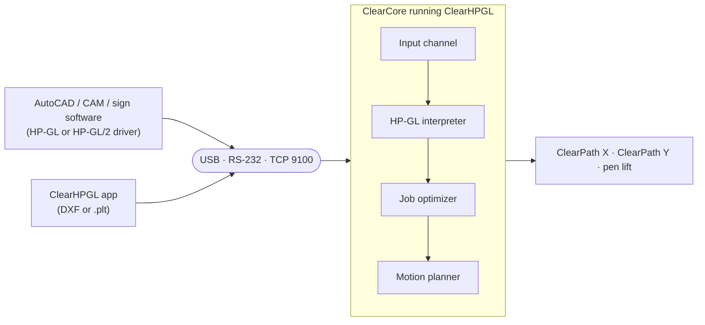

# ClearHPGL

**Build your own HP-GL plotter from industrial motion parts, and plot to it from the CAD software you already use.**

HP-GL is the language HP's pen plotters spoke, and it never went away. AutoCAD, CorelDRAW, sign software and many CAM tools can still "print" a drawing as HP-GL.

ClearHPGL is firmware that makes a [Teknic ClearCore](https://teknic.com/products/io-motion-controller/) controller with two ClearPath servos understand that language and behave like a real plotter. Point a plotter driver at the board's USB port, serial port or network address and it draws: no plugin, no converter, no special host software.

It comes with **ClearHPGL**, an optional Windows desktop app for previewing drawings, sending jobs and watching the pen move.

> [!WARNING]
> **Experimental.** ClearHPGL runs on a bench machine (ClearCore, ClearPath-SD servos on X and Y, pen on an output) and plots real jobs, including directly from AutoCAD. It is not certified for production or safety-critical use. Always keep a physical E-stop in the motor power circuit.

## Highlights

- **Plots from standard drivers.** Behaves like an HP 7475A or DraftMaster, so existing HP-GL and HP-GL/2 plotter drivers just work.
- **Three ways in.** USB virtual COM port, RS-232/TTL serial, or a raw TCP print port (9100).
- **Fixes CAD path order.** Buffers each job, joins broken outlines, cuts holes before outlines and takes the shortest route between shapes.
- **Smooth, coordinated motion.** Two-axis interpolation with lookahead, so curves flow at speed instead of stopping at every vertex.
- **Safety in the loop.** E-stop input, servo alerts and servo ready signals stop the machine and latch a fault.
- **Desktop app.** DXF and HP-GL preview with the firmware's own interpreter, live 3D view, job monitoring and machine setup.

## How it works



| Stage | What it does |
|-------|--------------|
| **Input channel** | Accepts jobs from any link, one source at a time; the others wait. Handles plotter flow control (XON/XOFF, ENQ/ACK) and `ESC.` device control, and strips the PCL/PJL wrappers Windows drivers add. |
| **HP-GL interpreter** | Turns HP-GL into geometry as an HP plotter would: scaling, rotation, clipping windows, arcs and circles, HP-GL/2 encoded polylines. Reports a configurable model, so 7475A and DraftMaster drivers both work, including the DraftMaster's centred origin. |
| **Job optimizer** | For jobs from CAD (USB and serial by default), buffers the whole job, joins touching strokes, draws everything inside a contour before the contour, and always moves to the nearest next shape. On the AutoCAD parts tested it cut pen-up travel by 45–65%. |
| **Motion planner** | Drives the servos as one coordinated machine with junction lookahead and acceleration limits. |
| **Safety** | Checks the E-stop input, ClearPath alerts and the servos' HLFB "ready" signal continuously. A fault disables the motors, drops the job and latches until cleared. |

The firmware drives two axes and a pen lift, so the natural build is a pen plotter of whatever size your mechanics allow. Any machine that raises and lowers a tool along 2D paths can be driven the same way. Tangential knife offsets for drag-knife cutting are not implemented. Laser engraving and cutting is a planned target; see [Roadmap](#roadmap).

## The desktop app

ClearHPGL (Qt 6, Windows) is optional, but it makes the machine much easier to use.

| Feature | Details |
|---------|---------|
| **Open** | DXF or HP-GL files. DXF drawings get the same cut ordering as the firmware and are checked for open contours and gaps, with one-click fixes. |
| **Preview** | Uses the firmware's own interpreter, compiled into the app, so position, rotation, scaling and clipping match what the board will draw. |
| **Plot and monitor** | Over Ethernet or serial. A 3D view of the bed shows the pen live and paints what has been drawn in green; the HP-GL line being drawn is highlighted; a cycle timer records the run. Jobs sent by other programs (AutoCAD on the USB port, for example) are followed the same way. |
| **Control** | Enable, pause, abort, jog, set origin, pen up/down, and the board's settings. |

## What you need

| Part | Notes |
|------|-------|
| Teknic ClearCore | Runs the firmware. |
| Two ClearPath-SD servos | Step and direction on M0 (X) and M1 (Y), with HLFB. |
| Pen lift | A solenoid or relay on a digital output (IO-0 by default), or a third ClearPath on M2. |
| E-stop | Wired to DI-6. Without one, `set estop_di6 0`. |
| Build tools | Microchip/Atmel Studio 7 for the firmware; Visual Studio 2022, CMake and Qt 6 (vcpkg) for the app. |

## Getting started

1. **Flash the firmware** to a USB-connected ClearCore:

   ```powershell
   ./Firmware/build.ps1 -Flash
   ```

2. **Configure the machine.** Open the USB port in a serial terminal and type `menu`. Use `config` to list the settings and `set <key> <value>` to change them. The essentials are steps per revolution and travel per revolution for each axis, the bed size, and speeds.

   The board uses DHCP by default. For a static address, `set net_mode 1`, set `ip`, `netmask` and `gateway`, then `restart`.

3. **Plot**, from `cmd.exe` or the command-line client:

   ```powershell
   copy /b drawing.plt COM3
   python Firmware/host/clearhpgl_cli.py discover
   python Firmware/host/clearhpgl_cli.py --host <ip> send drawing.plt
   ```

   Or open the drawing in the ClearHPGL app and press **Plot**.

## Plotting from AutoCAD

Either of AutoCAD's HP DraftMaster drivers can plot straight to the board:

| Driver | Output | Board setting |
|--------|--------|---------------|
| **DraftMaster RX 7596B** (HP-GL/2), recommended | True arcs and compact encoded polylines; places the plot itself | none |
| **Draftmaster 2 (7596A)** (HP-GL) | Arcs as short line segments; origin at the sheet centre | `set ident 7596A` |

To set it up:

1. Add a plotter with one of these models and point it at the board's COM port.
2. Add a custom paper size matching your bed, with no margins.
3. In **Configure Port**, set flow control to **XON/XOFF**.
4. Optionally, `set job_speed 0` on the board so its own pen speed is used instead of the speed AutoCAD sends.

AutoCAD's path order doesn't matter: the board reorders every job before plotting it.

## Roadmap

### Laser engraving and cutting

The goal: draw a part in AutoCAD, press Plot, and the laser cuts it. No CAM step and no separate laser software, just the plotter driver every CAD package already has.

Much of what a laser needs is already here:

- **Direct from CAD.** The same HP-GL and HP-GL/2 drivers, links and job handling.
- **Cut order.** The job optimizer already cuts everything inside a contour before the contour itself, so holes are cut before a part drops free or shifts, and travel between cuts is short.
- **Placement.** The interpreter positions the job on the bed exactly as the driver intended.

Still to build:

- **Laser control.** Fire on pen down with no settle delays, and set power (PWM) per job or per pen.
- **Power that follows speed.** Scale power with the actual path speed, so corners and slow-downs don't over-burn.
- **Interlocks.** Enclosure and lid switches, air assist and the E-stop must all be able to cut the beam, not just stop the motion.

> [!CAUTION]
> None of this is implemented. Do not connect a laser to the pen output: it would fire with plotter timing, without power control or interlocks.

## Documentation

- [Firmware/PROTOCOL.md](Firmware/PROTOCOL.md): connections and ports, supported HP-GL and HP-GL/2, device control, console commands, every setting with its default, and faults.
- `python Firmware/host/clearhpgl_cli.py --help`: the command-line client (discover, send, query, console).

**Not supported yet:** text (`LB`), area fills, line types and pen widths, homing and limit switches, and automatic pen changes.

## Building and testing

### App

```powershell
./build.ps1             # Release build, deployed with its Qt runtime
./build.ps1 -Install    # also installs to %LOCALAPPDATA%\Programs\ClearHPGL
```

`-Install` adds a Start-menu shortcut; pin that copy to the taskbar, since the build folder is rewritten on every build.

### Firmware

```powershell
./Firmware/build.ps1    # builds LwIP, libClearCore and the firmware; writes .bin and .uf2
```

Or open `Firmware/ClearCoreFirmware/ClearHPGL_Firmware.atsln` in Microchip Studio.

### Tests

No hardware needed:

```powershell
./Firmware/tests/run_tests.ps1                          # interpreter, input channel, job optimizer, interpolator
python Firmware/host/fake_plotter.py --bind 127.0.0.1   # stand-in board for testing the app
```

## Repository layout

| Path | Contents |
|------|----------|
| `Firmware/ClearCoreFirmware/` | The plotter firmware: interpreter, input channels, job optimizer, motion and pen control, USB and network transport, console, settings |
| `Firmware/tests/` | Host tests |
| `Firmware/host/` | Command-line client and fake board |
| `src/`, `resources/` | The desktop app |
| `tests/` | App test tools |
| `libClearCore/`, `LwIP/` | ClearCore library and TCP/IP stack the firmware builds on |
| `tools/` | Flashing and UF2 tools |
| `ProjectData/SampleDXF/` | Sample drawings |

## Background

ClearHPGL grew out of [EnhancedClearCoreLibrary](https://github.com/AGSweeney/EnhancedClearCoreLibrary), which extends Teknic's ClearCore library with coordinated two-axis motion and unit conversion. It was split into its own repository with its history.

The `libClearCore` copy here is kept in step with that library. Problems found while building the plotter (step bursts on small arcs, stalled TCP and USB transfers, faults on slow moves) were fixed here and backported there; see its `MODIFICATIONS.md`.
